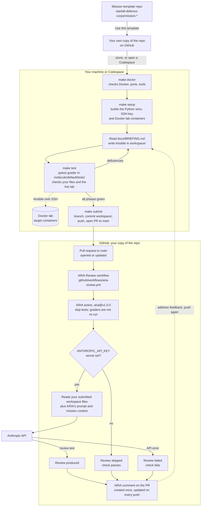

# Starfall Defence Corps Academy

> 🏠 **You are here: Academy Hub** · [📖 Course Outline](COURSE_OUTLINE.md) · [📚 Field Manuals](field-manuals/) · [🤖 ARIA](https://github.com/starfall-defence-corps/aria)

> *Training the next generation of cyber defence operators through gamified, hands-on Ansible training.*

**A hands-on course in defensive Ansible automation: 15 missions and 2 timed capstones, each a GitHub template repo with its own Docker lab and an automated grader.**

The Voidborn are probing the fleet. You defend it with code. Every mission drops you into a live lab — real containers, real SSH, real services — and asks you to harden, audit, test or recover it with Ansible. `make test` runs the mission's grader against the lab and tells you exactly which objectives pass. Open a pull request and **ARIA**, the Academy's AI analyst, adds a written review of your code.

| | |
|---|---|
| **You learn** | Inventory and ad-hoc commands → playbooks, templates, roles and Vault → Molecule testing, CIS compliance, rolling deployments, CI/CD → incident response and reusable runbooks |
| **You work in** | Your own copy of each mission repo (**Use this template**), locally with Docker or in a GitHub Codespace |
| **You are graded by** | A deterministic pytest grader per mission (`make test`), plus an optional AI code review on your pull request |
| **You need** | Basic Linux CLI and a GitHub account — see [Requirements](#requirements) |

**🚀 New cadet? Start here:** [enrol](#how-to-enrol) in [Mission 0 — Reporting for Duty](https://github.com/starfall-defence-corps/mission-0-reporting-for-duty) — a 15-minute environment shakeout that ends with your first green ARIA banner — then work through the missions in order.

**📖 Want the full picture?** The [Course Outline](COURSE_OUTLINE.md) has the lore, rank progression, and detailed briefings for every mission.

## Who This Is For

- **Primary**: military cyber defence teams — Blue Team analysts, SOC operators, sysadmins in uniform — who have seen what happens when hardening is done by hand.
- **Secondary**: anyone in IT security who wants to automate hardening, compliance and detection, and learn Ansible properly along the way.

No prior Ansible experience is assumed: Mission 0 gives you every command, and each Module 1 mission ships step-by-step exercises and hints. Scaffolding is reduced as you rise through the ranks, and the capstones are timed assessments with a briefing rather than a walkthrough — see [Rank Progression](COURSE_OUTLINE.md#rank-progression).

## Mission Map

*Every mission repo's README links back here via 🏠 Academy Hub — you can always find your way home.*

### Mission 0 — Enrolment · rank on completion: Midshipman

| # | Mission | What you practise |
|---|---------|-------------------|
| 0 | [Reporting for Duty](https://github.com/starfall-defence-corps/mission-0-reporting-for-duty) | Enrolment and environment check — boot a one-node lab, first Ansible command, first green banner in ~15 min |

### Module 1 — Foundation · rank on completion: Sub-Lieutenant

| # | Mission | What you practise |
|---|---------|-------------------|
| 1.1 | [Fleet Census](https://github.com/starfall-defence-corps/mission-1-1-fleet-census) | Inventory, ad-hoc commands, fact gathering |
| 1.2 | [Lock the Door](https://github.com/starfall-defence-corps/mission-1-2-lock-the-door) | Playbook fundamentals, SSH hardening, handlers |
| 1.3 | [Clean Sweep](https://github.com/starfall-defence-corps/mission-1-3-clean-sweep) | Service hardening, firewall, sysctl, file permissions |
| 1.4 | [Many Ships](https://github.com/starfall-defence-corps/mission-1-4-many-ships) | Variables, Jinja2 templates, conditionals, multi-OS (Ubuntu + Rocky Linux) |
| 1.5 | [Clean House](https://github.com/starfall-defence-corps/mission-1-5-clean-house) | Roles, Ansible Vault, secrets management, Git workflow |
| 1.6 | [Inventory from Nothing](https://github.com/starfall-defence-corps/mission-1-6-inventory-from-nothing) | Host discovery, service fingerprinting, dynamic inventory |
| 🎯 | [**Gateway Simulation** — Operation: First Contact](https://github.com/starfall-defence-corps/gateway-simulation) | **Capstone:** all Module 1 skills against a compromised outpost, 75 minutes, no step-by-step guide. Pass to earn **Lieutenant** |

### Module 2 — Advanced Individual Training

| # | Mission | What you practise |
|---|---------|-------------------|
| 2.1 | [Weapon Handling Test](https://github.com/starfall-defence-corps/mission-2-1-weapon-handling-test) | Molecule, Testinfra, test-driven infrastructure |
| 2.2 | [Compliance as Code](https://github.com/starfall-defence-corps/mission-2-2-compliance-as-code) | CIS benchmarks, Lynis scanning, tagged controls, triage against the clock |
| 2.3 | [Fleet Sync](https://github.com/starfall-defence-corps/mission-2-3-fleet-sync) | Rolling updates, delegation, health checks, `block`/`rescue` error handling |
| 2.4 | [Defence in Depth](https://github.com/starfall-defence-corps/mission-2-4-defence-in-depth) | CI/CD pipelines, ansible-lint, drift detection |
| 2.5 | [Noise Storm](https://github.com/starfall-defence-corps/mission-2-5-noise-storm) | Incident response, act 1 — key-only SSH, fail2ban, log forwarding, IOC blocking under live attack |
| 2.6 | [Counterattack](https://github.com/starfall-defence-corps/mission-2-6-counterattack) | Incident response, act 2 — persistence hunt and eradication, credential rotation, rolling remediation |
| 🎯 | [**Master Simulation** — Operation: Iron Curtain](https://github.com/starfall-defence-corps/master-simulation) | **Capstone:** assessment, remediation, testing, automation and a surprise incident across 6 mixed-OS nodes, 3.5 hours. Pass to earn **Lieutenant Commander** |

### Module 3 — MOS Specialisations · Build Your Battle Rattle

Module 3 makes your Module 2 manoeuvres **reusable across unfamiliar terrain**. Each specialisation produces a parameterised playbook for your personal **battle rattle** — the runbook portfolio you carry into the Final Exercise — graded for *portability*: the grader runs your same playbook against fresh scenarios, so hardcoded answers fail. Completing two or more MOS earns **Commander**. See the [Course Outline](COURSE_OUTLINE.md#module-3-mos-specialization--build-your-battle-rattle).

| MOS | Mission | What you practise |
|-----|---------|-------------------|
| 4 | [Eyes Everywhere](https://github.com/starfall-defence-corps/mission-3-4-eyes-everywhere) | Telemetry at scale — rsyslog forwarding, audit rules, an osquery-style agent; graded on whether events actually arrive at the collector |
| 5 | [Battle Rattle](https://github.com/starfall-defence-corps/mission-3-5-battle-rattle) | Incident-response automation — four reusable `runbooks/<verb>.yml` (block-ioc, collect-triage, rotate-creds, restore-service), each re-run against two randomised scenarios |

> **In development:** MOS 1, 2, 3 and 6 (Windows, network, Kubernetes and cloud hardening) need VM labs beyond the Docker setup, and the Final Exercise (Operation: Enduring Shield, rank of Captain) is not yet published — see the [roadmap](COURSE_OUTLINE.md#roadmap).

### Field Manuals — Reference Library

| Manual | Topic |
|--------|-------|
| [FM-1](field-manuals/FM-1-ansible-reference.md) | Ansible Module Reference — blue team module cards |
| [FM-2](field-manuals/FM-2-yaml-jinja2-reference.md) | YAML & Jinja2 Quick Reference |
| [FM-3](field-manuals/FM-3-molecule-testing-reference.md) | Molecule & Testing Reference |
| [FM-4](field-manuals/FM-4-cis-compliance-reference.md) | CIS & Compliance Reference |
| [FM-5](field-manuals/FM-5-glossary.md) | Glossary — technical + lore terms |
| [FM-6](field-manuals/FM-6-faq-simulation-hub.md) | FAQ & Simulation Hub |

## How a Mission Works

Every mission repo runs the same loop: you work and grade locally against a Docker lab, then a pull request in your own copy triggers ARIA's written review. The grader is local and deterministic; the review is qualitative and sits on top.

In short: you create your own copy of a mission repo from its template, boot its Docker lab with `make setup`, and iterate on `workspace/` until `make test` — the mission's pytest grader — shows every phase green. `make submit` then pushes a branch and opens a pull request to `main` in your copy. Every time that pull request is opened or updated, the mission's `aria-review.yml` workflow runs the shared ARIA action with `skip-tests`, so the graders are **not** re-run in CI. If your repo has an `ANTHROPIC_API_KEY` secret, ARIA sends your submitted files to the Anthropic API with its reviewer prompt and the mission's context, and the workflow posts the result as a single PR comment that it updates on each push. Without a key the comment says the review was skipped; if the API call fails the comment says so and the check fails.

- **`make test` is the source of truth.** Each mission's grader lives in `molecule/default/tests/`, checks your workspace files and, where the mission needs it, drives Ansible against the running lab containers, then reports phase by phase. It needs no API key.
- **The pull request review is qualitative.** ARIA reviews the files you submitted — structure, security, recommendations — and the comment headline never marks a mission complete.
- **The PR is your record.** It is never merged into the Academy's repo; your copy, with its PR history and ARIA's feedback, is your portfolio.

## How to Enrol

1. Navigate to your assigned mission repo (see the [Mission Map](#mission-map))
2. Click **Use this template** → **Create a new repository** (this creates your own copy)
3. Name your repo (e.g., `mission-0-reporting-for-duty`), set it to **Public**
4. Clone your new repo locally and run `make doctor` — it checks your machine is mission-ready
5. Follow the README inside: `make setup` boots the lab, `make test` asks ARIA to verify your work
6. Done? `make submit` branches, commits, pushes, and opens your review PR in one command (needs the [GitHub CLI](https://cli.github.com/), signed in with `gh auth login`)

> **Important**: Use **"Use this template"**, not "Fork". Templates give you a clean copy with no link back to the original.

## Requirements

**Skills**: basic Linux CLI (you can `ls`, `cd`, `grep` and `ssh` without looking them up) and a GitHub account.

**Zero-setup option**: every mission repo ships a devcontainer — after creating your copy, open it with **Code → Codespaces → Create codespace** and skip all the installs below. First boot takes ~5 minutes (one-time); the free tier covers ~30 hours/month on the lab machine. Partway through, click the **"Building the codespace"** notification in the lower-right corner and accept the workspace-trust prompt when it appears — the build waits indefinitely if you don't.

**Running locally instead:**

- **Docker Desktop** (running, with Docker Compose v2)
- **GNU Make**
- **Ansible** (`ansible-core`)
- **Python 3.10+** (with `python3-venv` on Debian/Ubuntu)
- **Git**
- **GitHub CLI** (`gh`) — only for `make submit`; you can also push and open the PR by hand

> **Windows users**: Install [WSL2](https://learn.microsoft.com/en-us/windows/wsl/install) and run all commands from your WSL terminal. Docker Desktop should use the WSL2 backend.

## ARIA — Your Automated Reviewer

**ARIA** (Automated Review & Intelligence Analyst) reviews your work in two ways:

**Locally** — run `make test` to get instant pass/fail verification. No API key needed. Works offline.

**On Pull Request** — when you push your work and open a PR to `main`, ARIA reads your files and posts a qualitative code review as a PR comment (structure, security, recommendations).

To enable PR reviews, add an API key to your repo:
1. Get a key from [platform.claude.com](https://platform.claude.com/)
2. In your repo: **Settings** > **Secrets and variables** > **Actions** > **New repository secret**
3. Name: `ANTHROPIC_API_KEY`, Value: your key

If no key is configured, ARIA skips the PR review — local testing still works.

ARIA is a shared GitHub Action that every mission's workflow calls. Its inputs, what it reads, and its security posture are documented in the [aria repository](https://github.com/starfall-defence-corps/aria).

## Repositories

| Repo | Purpose |
|------|---------|
| [`sdc-academy`](https://github.com/starfall-defence-corps/sdc-academy) | This hub — enrolment, [Course Outline](COURSE_OUTLINE.md), [Field Manuals](field-manuals/) |
| [`aria`](https://github.com/starfall-defence-corps/aria) | ARIA — the shared review GitHub Action and the `aria-reporter` pytest plugin used by every grader |
| `mission-*`, `gateway-simulation`, `master-simulation` | The 17 mission template repos listed in the [Mission Map](#mission-map) |

## About

Built by the Starfall Defence Corps for cadets who learn by doing, not by reading.

## Licence

MIT. See [LICENSE](LICENSE).
